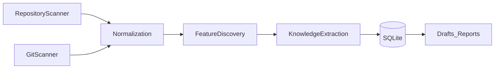
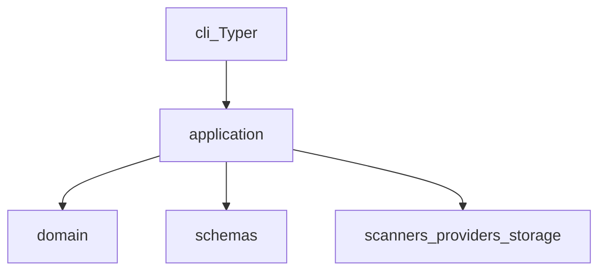

# Skald

<p align="center">
  
</p>

<p align="center">
  <strong>Local-first developer knowledge pipeline</strong><br />
  Turn Git engineering activity into structured metadata, feature catalogs, and grounded content drafts.
</p>

<p align="center">
  <a href="#-english">🇺🇸 English</a> ·
  <a href="#-português">🇧🇷 Português</a>
</p>

<p align="center">
  
  
  
  
  
  
</p>

---

# 🇺🇸 English

## Table of contents

- [Overview](#overview)
- [Features and usability](#features-and-usability)
- [Technical stack](#technical-stack)
- [Architecture](#architecture)
- [Project structure](#project-structure)
- [Getting started](#getting-started)
- [Usage](#usage)
- [CLI reference](#cli-reference)
- [Configuration](#configuration)
- [Development](#development)
- [Testing](#testing)
- [Security](#security)
- [Roadmap](#roadmap)
- [License](#license)

## Overview

**Skald** (Norse: knowledge keeper / poet) is a local-first CLI that extracts reusable technical knowledge from Git repositories. Brand mark: [`public/favicon.ico`](public/favicon.ico).

It is aimed at developers who want evidence-backed feature metadata and draft content—not a hosted analytics SaaS and not an ungrounded LLM article generator.

**Pipeline:** Repository scan → Git history → Normalization → Feature discovery → Knowledge extraction → SQLite catalog → Content drafts / reports.

## Features and usability

| Capability | Status |
|------------|--------|
| `skald init` workspace + SQLite | Implemented |
| Scan local repo structure / docs / deps / CI hints | Implemented |
| Ingest commit history (incremental, truncated diffs) | Implemented |
| List public GitHub repos (`GITHUB_TOKEN` optional) | Implemented |
| Deterministic feature grouping + metadata extraction | Implemented |
| Features list / show / YAML export | Implemented |
| Markdown drafts (article, learning-note, linkedin) | Implemented |
| Terminal activity report | Implemented |
| Real LLM provider / semantic embeddings grouping | Planned |
| Full GitHub commit/PR sync | Planned |

**Typical journey:** `init` → `scan repo` + `scan git` → `analyze` → `features list` → `content draft` → `report`.

## Technical stack

| Area | Technology | Role |
|------|------------|------|
| Language | Python 3.10+ (3.11+ recommended) | Runtime |
| CLI | Typer, Click, Rich | Commands and terminal UX |
| Models | Pydantic v2, pydantic-settings | Schemas and config |
| Git | GitPython | Local history and tree |
| HTTP | httpx | Optional GitHub listing |
| Persistence | SQLAlchemy 2, SQLite, Alembic | Knowledge catalog |
| Templates | Jinja2 | Content drafts |
| Quality | pytest, ruff, mypy | Dev extras |

## Architecture

Canonical diagrams and layer notes: [docs/architecture.md](docs/architecture.md).





**Implementation notes (not formal ADRs):** CLI stays thin; use cases live in `application/`; grouping is deterministic and configurable; LLM enrichment uses a mock provider offline by default.

## Project structure

```text
skald/
├── public/favicon.ico     # Product logo
├── src/skald/             # Package + CLI entry (skald)
│   ├── cli/               # Typer commands
│   ├── application/       # Use cases
│   ├── domain/            # Grouping + ports
│   ├── analysis/          # Normalization, features, knowledge
│   ├── scanners/          # Repo / git scanners
│   ├── providers/         # Git, GitHub, LLM adapters
│   ├── storage/           # SQLAlchemy models
│   ├── schemas/           # Pydantic contracts
│   ├── content/           # Jinja drafts
│   └── core/              # Config, container, logging
├── tests/                 # Unit + integration
├── examples/sample-repo/  # Demo Git history
├── docs/                  # Architecture, schema, development
├── alembic/               # Migrations scaffold
└── pyproject.toml
```

## Getting started

### Prerequisites

- Python 3.10+ (3.11+ recommended)
- Git available on `PATH`

### Install

```bash
git clone <this-repo>
cd skald
python3 -m venv .venv
source .venv/bin/activate
pip install -e ".[dev]"
```

### Verify

```bash
skald --help
```

## Usage

```bash
skald init

skald scan repo ./examples/sample-repo
skald scan git ./examples/sample-repo

skald analyze
skald features list
skald features show <FEATURE_ID>
skald features export <FEATURE_ID> --format yaml
skald content draft <FEATURE_ID> --format article
skald report
```

Optional GitHub listing:

```bash
export GITHUB_TOKEN=...   # never commit real tokens
skald scan github --user octocat
```

## CLI reference

| Command | Description |
|---------|-------------|
| `skald init` | Create config, workspace, SQLite |
| `skald scan repo PATH` | Repository metadata |
| `skald scan git PATH` | Commit history (incremental) |
| `skald scan github --user U` | List public repositories |
| `skald analyze` | Feature discovery + knowledge extraction |
| `skald features list\|show\|export` | Feature catalog |
| `skald content draft ID --format F` | Jinja Markdown draft (`article`, `learning-note`, `linkedin`) |
| `skald report` | Activity summary |

## Configuration

| Item | Location / name |
|------|-----------------|
| Default config | `~/.config/devlog/config.yaml` |
| Workspace | `~/.devlog` (`skald.db`, artifacts, content) |
| Workspace override | `SKALD_WORKSPACE` |
| Database URL override | `SKALD_DATABASE_URL` (Alembic / advanced) |
| GitHub token | `GITHUB_TOKEN` (env only) |

See [`.env.example`](.env.example) for variable names (placeholders only).

## Development

```bash
pip install -e ".[dev]"
ruff check src tests
ruff format src tests
mypy src/skald
```

Details: [docs/development.md](docs/development.md), [docs/metadata-schema.md](docs/metadata-schema.md).

## Testing

```bash
pytest
```

Integration tests use temporary Git repositories under `tests/`.

## Security

- Scan excludes sensitive path patterns (e.g. `.env`, keys).
- Tokens come from the environment and must not be logged or committed.
- Local SQLite workspace stays on the operator machine by default.

## Roadmap

Documented intentions (not shipped):

- GitHub commit/PR ingestion
- Real LLM provider with grounded structured output
- Semantic commit grouping (embeddings)

## License

MIT — see [LICENSE](LICENSE).

---

# 🇧🇷 Português

## Sumário

- [Visão geral](#visão-geral)
- [Funcionalidades e usabilidade](#funcionalidades-e-usabilidade)
- [Stack tecnológica](#stack-tecnológica)
- [Arquitetura](#arquitetura)
- [Estrutura do projeto](#estrutura-do-projeto)
- [Primeiros passos](#primeiros-passos)
- [Utilização](#utilização)
- [Referência da CLI](#referência-da-cli)
- [Configuração](#configuração)
- [Desenvolvimento](#desenvolvimento)
- [Testes](#testes)
- [Segurança](#segurança)
- [Roadmap](#roadmap-1)
- [Licença](#licença)

## Visão geral

**Skald** (nórdico: guardião do conhecimento / poeta) é um CLI local-first que extrai conhecimento técnico reutilizável de repositórios Git. Logo: [`public/favicon.ico`](public/favicon.ico).

Não é um dashboard SaaS de analytics nem um gerador cego de artigos por LLM. O MVP gera metadados e rascunhos a partir de evidências do repositório.

**Pipeline:** scan do repositório → histórico Git → normalização → descoberta de features → extração de conhecimento → catálogo SQLite → rascunhos / relatórios.

## Funcionalidades e usabilidade

A tabela de status da [seção em inglês](#features-and-usability) aplica-se aqui. Jornada típica: `init` → `scan` → `analyze` → `features` → `content draft` → `report`.

## Stack tecnológica

Python 3.10+, Typer/Rich, Pydantic, GitPython, httpx, SQLAlchemy/SQLite/Alembic, Jinja2, pytest/ruff/mypy — detalhada em [Technical stack](#technical-stack).

## Arquitetura

Diagramas Mermaid canônicos em [docs/architecture.md](docs/architecture.md). Resumo no README inglês: [Architecture](#architecture) (pipeline + camadas DDD).

## Estrutura do projeto

Igual à árvore em [Project structure](#project-structure). O logo do produto está em `public/favicon.ico`.

## Primeiros passos

```bash
cd skald
python3 -m venv .venv
source .venv/bin/activate
pip install -e ".[dev]"
skald --help
```

Python 3.11+ recomendado; metadados permitem 3.10+.

## Utilização

```bash
skald init
skald scan repo ./examples/sample-repo
skald scan git ./examples/sample-repo
skald analyze
skald features list
skald content draft <FEATURE_ID> --format article
skald report
```

## Referência da CLI

Mesmos comandos da [CLI reference](#cli-reference).

## Configuração

- Config: `~/.config/devlog/config.yaml`
- Workspace: `~/.devlog`
- Override: `SKALD_WORKSPACE`
- Token GitHub: `GITHUB_TOKEN` (somente ambiente)

Ver [`.env.example`](.env.example).

## Desenvolvimento

```bash
pytest
ruff check src tests
mypy src/skald
```

Ver [docs/development.md](docs/development.md) e [docs/metadata-schema.md](docs/metadata-schema.md).

## Testes

```bash
pytest
```

## Segurança

Exclusão de caminhos sensíveis nos scans; tokens só via ambiente; workspace SQLite local.

## Roadmap

Ver [Roadmap](#roadmap) (inglês): ingestão GitHub completa, LLM real, agrupamento semântico — planejado, não implementado.

## Licença

MIT — [LICENSE](LICENSE).
