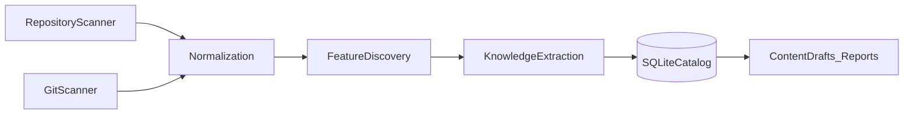
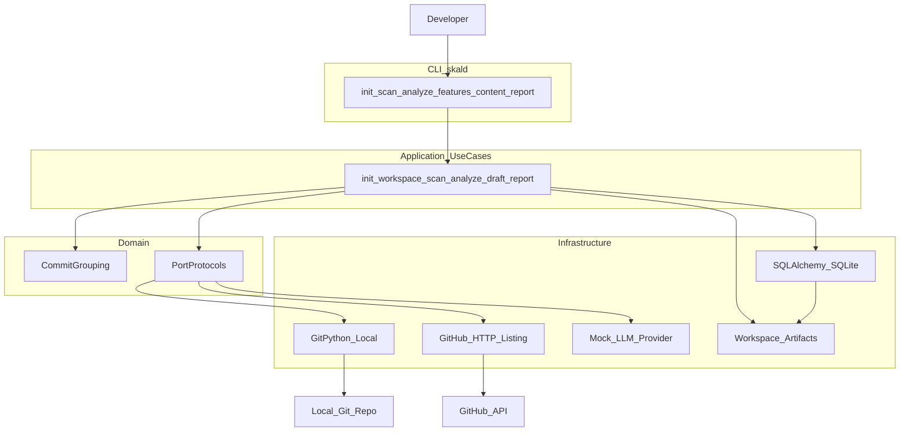
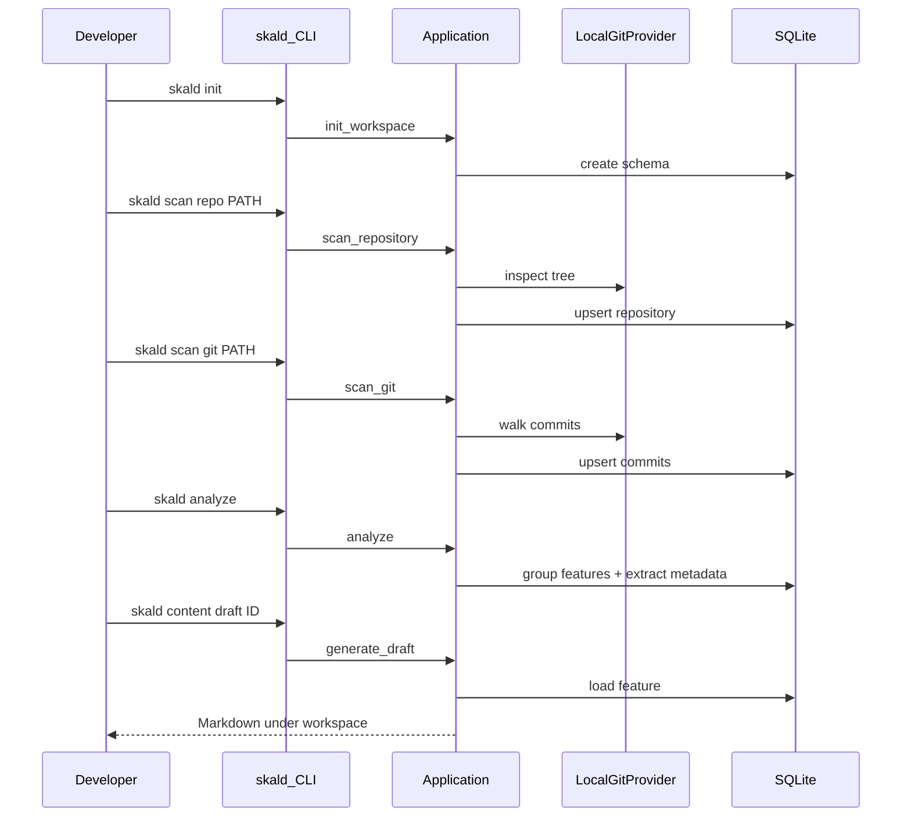
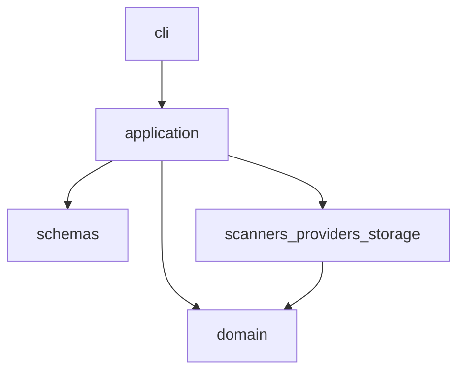

# Skald architecture

Skald is a **local-first knowledge extraction pipeline**. It is not a generic Git dashboard or an automatic article bot.

Brand asset: [`../public/favicon.ico`](../public/favicon.ico).

## Pipeline overview

## System context

## CLI to use-case flow

## Layers (DDD)

| Layer | Responsibility |
|-------|----------------|
| `cli/` | Typer adapters; no business logic |
| `application/` | Use cases (init, scan, analyze, content, report) |
| `domain/` | Pure grouping logic and port protocols |
| `scanners/`, `providers/`, `storage/` | Infrastructure adapters |
| `schemas/` | Pydantic contracts (JSON/YAML) |

## Extension points

- `providers/git/local.py` — GitPython
- `providers/git/github.py` — public repo listing (commits/PR sync planned)
- `providers/llm/mock.py` — offline enrichment; swap for a real LLM provider
- `analysis/commit_grouping.py` — `SemanticGroupingStrategy` placeholder

## Persistence

- SQLite via SQLAlchemy (`storage/models.py`)
- Artifacts: diffs, exported YAML, generated Markdown under workspace
- Alembic scaffold in `alembic/` (schema also created on init via metadata)

## Security

- Sensitive paths (`.env`, keys, secrets patterns) excluded from scans
- GitHub tokens read from environment only; never logged
